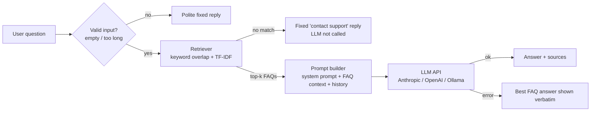

# LearnSphere FAQ Chatbot

An AI-powered FAQ chatbot. It answers questions from a JSON knowledge base of 37 FAQs, uses a Large
Language Model (LLM) to write natural replies, remembers the conversation, and says so when it
doesn't know instead of making things up. The UI is built with Streamlit.

> The FAQ content is for a fictional online-learning platform, "LearnSphere". To use your own topic, just
> replace `data/faqs.json` (and the company name in `faq_chatbot/prompts.py`).

## How it works

This is a small **retrieval-augmented generation (RAG)** pipeline:



1. **Retrieve** - the question is tokenised (lower-cased, stop-words removed, light stemming) and scored
   against every FAQ with `0.6 x keyword overlap + 0.4 x TF-IDF cosine similarity`.
2. **Guard** - if nothing scores above `MIN_SCORE`, the bot replies with a fixed message and **never calls the
   LLM**, so it cannot hallucinate an answer to an out-of-scope question.
3. **Generate** - otherwise the top FAQs are sent to the LLM inside `<faq_context>` tags, together with a
   system prompt that says "answer only from this context" and the recent conversation history.
4. **Degrade gracefully** - if the API is unreachable, rate-limited or the key is wrong, the user still gets the
   best matching FAQ answer.

## Project structure

```
faq-chatbot/
├── app.py                  # Streamlit user interface
├── data/faqs.json          # Knowledge base (37 FAQs)
├── faq_chatbot/
│   ├── config.py           # Settings from environment variables / .env
│   ├── retriever.py        # FAQ loading, tokenising, keyword + TF-IDF retrieval
│   ├── prompts.py          # System prompt, user-prompt builder, fixed replies
│   ├── llm_client.py       # HTTP client for LLM APIs, retries, error handling
│   └── chatbot.py          # Conversation logic and history
├── tests/                  # pytest suite (43 test runs, no network needed)
├── docs/TEST_CASES.md      # Documented test cases + manual accuracy checks
├── requirements.txt
├── .env.example            # Template for your secrets (copy to .env)
└── README.md
```

## Installation

Requires **Python 3.10+**.

```bash
# 1. Get the code
git clone <your-repo-url>
cd faq-chatbot

# 2. Create a virtual environment
python -m venv .venv
source .venv/bin/activate          # Windows: .venv\Scripts\activate

# 3. Install dependencies
pip install -r requirements.txt

# 4. Configure your LLM
cp .env.example .env               # Windows: copy .env.example .env
# then open .env and set LLM_PROVIDER and LLM_API_KEY
```

### Choosing an LLM

| `LLM_PROVIDER` | What it uses | Needs key? |
|----------------|--------------|-----------|
| `anthropic` (default) | Claude via the Anthropic Messages API (default model `claude-haiku-5-5`) | Yes |
| `openai` | OpenAI Chat Completions API (default model `gpt-4o-mini`) | Yes |
| `ollama` | A **locally running** model served by [Ollama](https://ollama.com) (default `llama3.2`; run `ollama pull llama3.2` first) | No |
| `none` | Retrieval-only: returns the best-matching FAQ answer, no LLM | No |

Change the model with `LLM_MODEL`, or point at any OpenAI-compatible server with `LLM_BASE_URL`.

## Running the app

```bash
streamlit run app.py
```

Open the URL Streamlit prints (usually http://localhost:8501). Try the sample questions in the sidebar.

## Running the tests

```bash
pytest -v
```

The tests use a fake LLM and fake HTTP responses, so they need no API key and no internet.
See [`docs/TEST_CASES.md`](docs/TEST_CASES.md) for the full list of documented test cases and the manual
accuracy checklist for a live model.

## Configuration reference

All settings are environment variables (or lines in `.env`):

| Variable | Default | Meaning |
|----------|---------|---------|
| `LLM_PROVIDER` | `anthropic` | `anthropic`, `openai`, `ollama` or `none` |
| `LLM_API_KEY` | - | API key (also accepts `ANTHROPIC_API_KEY` / `OPENAI_API_KEY`) |
| `LLM_MODEL` | provider default | Model name |
| `LLM_BASE_URL` | provider default | API base URL |
| `LLM_TEMPERATURE` | `0.2` | Lower = more predictable answers; empty = don't send |
| `LLM_MAX_TOKENS` | `400` | Maximum length of a reply |
| `LLM_TIMEOUT` | `30` | Seconds before a request is abandoned |
| `FAQ_PATH` | `data/faqs.json` | Knowledge-base file |
| `TOP_K` | `3` | FAQ entries given to the LLM |
| `MIN_SCORE` | `0.25` | Minimum retrieval score; below this the bot says it doesn't know |
| `MAX_HISTORY_MESSAGES` | `8` | Messages (4 turns) of history sent to the LLM |
| `MAX_INPUT_CHARS` | `500` | Longest accepted user message |

## Adding or editing FAQs

Each entry in `data/faqs.json` looks like this:

```json
{
  "id": "refund-policy",
  "category": "Billing",
  "question": "What is your refund policy?",
  "answer": "You can request a full refund within 14 days...",
  "keywords": ["refund", "money back", "reimburse"]
}
```

Keywords are how people actually phrase the question ("money back", "2fa"). Add a few synonyms for
every entry, then run `pytest` to check nothing else broke.

## Responsible AI practices

- **API keys** live only in `.env` (git-ignored) or real environment variables, are hidden from `repr`/logs,
  and are never included in error messages. Never commit `.env`.
- **Reducing hallucinations:** grounding the model in retrieved FAQ text, an explicit "say you don't know"
  rule, low temperature, a fixed reply (no LLM call) when retrieval finds nothing, and showing the FAQ
  entries used for each answer so users can check them.
- **Prompt-injection awareness:** user text and FAQ content are treated as data, kept out of the system prompt,
  and the model is told not to follow instructions found there.
- **Data handling:** conversation history exists only in the browser session's memory; nothing is written to
  disk. The only data sent to the LLM provider is the question, recent turns and the retrieved FAQ text.
  Users are told not to share passwords or card numbers.
- **Limits on input** (`MAX_INPUT_CHARS`) and history (`MAX_HISTORY_MESSAGES`) control cost and keep prompts
  inside the model's context window.

## Known limitations

- Retrieval is lexical (words and TF-IDF), not semantic. A question that shares no words with an FAQ
  ("how do I get my cash returned") can be missed unless the keywords cover it. Embeddings would fix this.
- Some out-of-scope questions share a word with an FAQ (for example "do you sell laptops" overlaps with
  "do you sell my data") and reach the LLM; the system prompt then has to make it decline.
- LLMs can still occasionally rephrase inaccurately. Always compare against the "FAQ entries used" panel.
- Follow-up handling is simple: only very short unmatched messages are merged with the previous question.
- English only.

## Publishing to GitHub

```bash
git init
git add .
git commit -m "AI-powered FAQ chatbot"
git branch -M main
git remote add origin https://github.com/<your-username>/<repo-name>.git
git push -u origin main
```

Check that `git status` does **not** list `.env` before your first commit.
